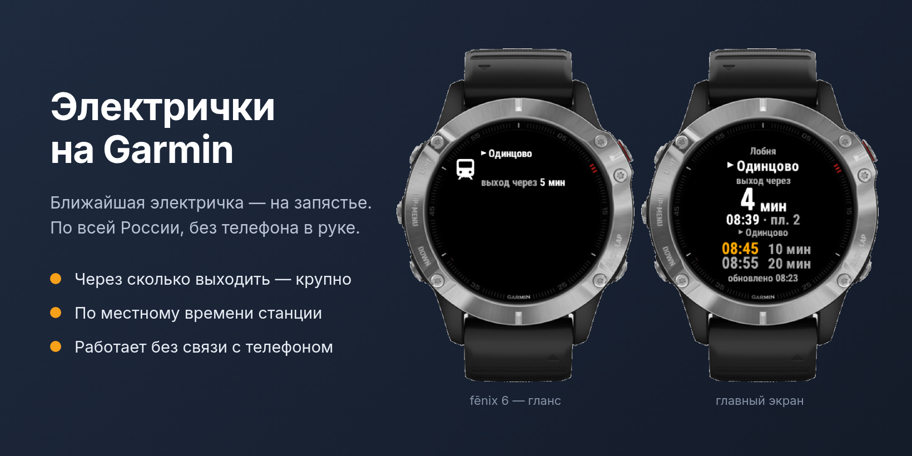
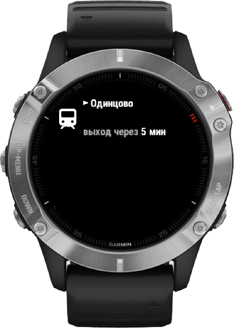
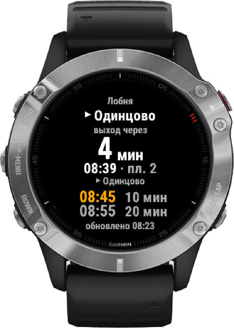

<div align="center">

# Электрички на Garmin — Russian Trains

**Ближайшая электричка — на запястье. Без телефона в руке.**

Виджет для часов Garmin с расписанием электричек по всей России — от МЦД
до Калининграда и Новосибирска: куда идёт поезд, когда он уходит и через
сколько минут вам выходить из дома.

[](https://github.com/andreiyurik/garmin-russia-trains/actions/workflows/proxy.yml)


[](LICENSE)



</div>

> **Статус: бета.** Приложение проверено в симуляторе Connect IQ на живом
> расписании Яндекса в нескольких регионах и часовых поясах; проверка на часах
> и публикация — следующий шаг. В Connect IQ Store его пока нет.

## Проблема

Утро, вы бежите к станции. Чтобы узнать, успеваете ли на электричку, нужно
достать телефон, разблокировать его, открыть приложение, дождаться загрузки и
найти свой маршрут. Это 20–30 секунд — в перчатках, с сумкой, на ходу.

На часах Garmin, которые уже на руке, такой информации не было: в Connect IQ
Store нет ни одного приложения с расписанием российских электричек (поиск по
магазину, октябрь 2026).

## Решение

Поднимите руку — и сразу видно главное:

- **Куда и когда.** Гланс в ленте виджетов показывает ближайший поезд и минуты
  до него, ничего не нужно открывать.
- **Одно главное число.** Посреди экрана крупно — через сколько минут ваш
  поезд. Укажите дорогу до станции, и это будет **«выход через 4 мин»**; когда
  пора, число становится оранжевым, а потом — «Выходите!». Поезда, на которые
  уже не успеть, не занимают место на экране.
- **Утром — на работу, вечером — домой.** Направление выбирается само по
  времени суток. Кнопка START разворачивает его.
- **Где садиться.** Для ближайшего поезда — конечная и платформа. Экспрессы
  помечены, их можно скрыть: на них нужен другой билет.
- **Работает без телефона.** Расписание на 3 дня хранится в часах и
  обновляется в фоне раз в час. Внизу экрана видно, когда оно загружено.
- **Время станции.** Время отправления — как на табло вашей станции
  (Екатеринбург, Новосибирск, Калининград), а «через сколько минут» верно,
  даже если часы живут в другом поясе. Тогда внизу экрана виден пояс станции,
  например «UTC+3».
- **Честно о проблемах.** «Станция не найдена: …», «Уточните станцию:
  Перово, Москва?», «Нет связи с телефоном», «Лимит запросов, позже» — вместо
  пустого экрана или выдуманных данных.

## Скриншоты

<table>
  <tr>
    <td align="center" width="50%">
      <br>
      <b>Гланс на fēnix 6</b><br>
      Куда и через сколько выходить — прямо в ленте виджетов,
      без открытия приложения
    </td>
    <td align="center" width="50%">
      <br>
      <b>Главный экран</b><br>
      Крупно — через сколько выходить к вашему поезду, под ним время,
      платформа и конечная, ниже — следующие поезда. Жёлтое время — экспресс
    </td>
  </tr>
</table>

<sub>Снимки из симулятора Connect IQ SDK (fēnix 6) на тестовом расписании.</sub>

## Как начать

1. Установите виджет на часы.
2. В приложении Garmin Connect: **Connect IQ → Электрички → Настройки**.
3. Укажите станции **«Дом»** и **«Работа»** — просто названием, например `Одинцово`.
   Одноимённые станции различаются по второй станции маршрута: `Заводская` +
   `Ижевск` — это Ижевск. Если этого мало, виджет попросит уточнить, и можно
   дописать город, регион или направление через запятую: `Заводская, Находка`,
   `Депо, Казанское`.
4. Укажите **«Дорогу до станции»** в минутах.

Кнопки: **START** — развернуть направление, **MENU** (долгое нажатие UP) —
обновить расписание сейчас, **BACK** — выход, как в любом приложении Garmin.

## Как это устроено

```
[часы] ←Bluetooth→ [Garmin Connect на телефоне] → [Cloudflare Worker] → [API Яндекс.Расписаний]
```

- **Часы** (`watch/`, Monkey C) — виджет с глансом. Фоновый сервис раз в час
  докачивает недостающие дни в `Application.Storage`; гланс и экран только
  читают сохранённое и не ходят в сеть.
- **Прокси** (`proxy/`, Cloudflare Workers) находит станции по названию среди
  13 800 станций России, выбирая из одноимённых ближайшую пару, забирает у
  Яндекса оба направления за день и отдаёт часам 0,2–5 КБ: каждый поезд — одно
  число, плюс часовые пояса станций. Так плотное расписание помещается в 32 КБ
  памяти гланса и быстро идёт по Bluetooth (400–800 байт/с по документации Garmin).
- **Общий кэш.** Готовые дни лежат в Workers KV 12 часов и общие для всех
  часов на маршруте, в обе стороны: запросы к Яндексу растут с числом
  маршрутов, а не пользователей. Если Яндекс не отвечает или дневной лимит
  исчерпан, прокси отдаёт последнее сохранённое расписание и до полуночи по
  Москве к Яндексу не ходит.

## Надёжность

- **По правилам Garmin.** Структура и механики взяты из официальной
  документации и примеров Connect IQ SDK (WebRequest, BackgroundTimer,
  ApplicationStorage, Menu2): родные меню и индикатор загрузки, системные
  шрифты, лимиты памяти и времени фоновых задач, UX Guidelines.
- **Тесты.** 37 юнит-тестов часов (фреймворк Run No Evil, запускаются в
  симуляторе) и 42 теста прокси; CI на каждый push. Логика получает текущее
  время параметром, поэтому полночь, последний поезд дня и устаревание кэша
  проверяются явно.
- **Защита от плохих данных.** Ответ сервера проверяется до сохранения;
  при ошибке остаётся последнее рабочее расписание.
- **Память измерена.** Самый плотный маршрут России, Мытищи — Ярославский
  вокзал (536 поездов в сутки), в глансе fēnix 6: 17 из 27,8 КБ. День хранится
  по направлениям, и гланс загружает только нужное.
- **Старые настройки работают.** Полные названия, которые находились в
  версии только для Москвы, дают ту же станцию, а у одноимённых «N км» —
  ближайшую ко второй станции маршрута: проверено на 55 000 парах московских
  станций.

## Устройства

| Устройство | Статус |
|---|---|
| fēnix 6 / 6S / 6 Pro / 6S Pro / 6X Pro | основная цель: сборка, юнит-тесты, гланс и главный экран проверены в симуляторе (6, 6S) |
| vívoactive 4 / 4S / 5 / 6 | собирается, главный экран проверен в симуляторе (4S, 5) |

## Планы

### Версия 1.1 — вся Россия

- ✅ **Электрички по всей стране**, одинаковые названия станций, часовые пояса
  и общий кэш.
- **Дополнительные маршруты.** До трёх избранных, например дача или родители, —
  в меню виджета.
- **Больше часов.** Forerunner 245/255/265/955/965, fēnix 7/8, epix, Venu,
  Instinct 2/3 с отдельной раскладкой для монохромного экрана.
- **Публикация в Connect IQ Store** на русском и английском.

### Дальше

- Веб-страница настройки с поиском станций по первым буквам.
- Подсказка «успеешь шагом / бегом» по GPS.
- Задержки в реальном времени — если появится открытый источник.

## Разработка

Нужны [Connect IQ SDK](https://developer.garmin.com/connect-iq/sdk/) и файлы
устройств (SDK Manager → Devices).

```sh
./test.sh          # тесты прокси, строгая сборка под все устройства, юнит-тесты в симуляторе
./test.sh proxy    # только прокси (это же запускает GitHub Actions)
```

Запуск в симуляторе:

```sh
monkeyc -f watch/monkey.jungle -d fenix6 -o bin/app.prg -y ~/.Garmin/ConnectIQ/keys/developer_key.der -l 3
connectiq && monkeydo bin/app.prg fenix6
```

На свои часы и в магазин — [`store/README.md`](store/README.md):

```sh
./release.sh install fenix6 --home Одинцово --work Беговая   # release-сборка на часы по USB
./release.sh iq                                              # пакет для Connect IQ Store
```

Прокси:

```sh
cd proxy
YANDEX_API_KEY=… npm run stations   # пересобрать src/stations.json
npx wrangler login                  # один раз
npm run deploy                      # собирает станции, кладёт секрет, деплоит воркер
curl "<worker-url>/?q=Заводская"    # где эта станция и как её вписать в настройки
```

Ключ API — на [developer.tech.yandex.ru](https://developer.tech.yandex.ru)
(«API Яндекс.Расписаний»); скрипт берёт его из `~/.config/mcd-garmin/yandex_key`.
URL воркера задаётся свойством `ProxyUrl` в `watch/resources/settings/properties.xml`.
Иконка: `watch/art/launcher_icon.svg`, размеры под устройства —
`watch/art/build-icons.sh`.

Идеи интерфейса подсмотрены у [Avgånär](https://github.com/felwal/avganar)
(Стокгольм, GPL-3.0).

## Данные

Данные предоставлены сервисом [Яндекс.Расписания](https://rasp.yandex.ru).
Личные данные приложение не собирает: [политика конфиденциальности](PRIVACY.md).

## Лицензия

[GPL-3.0](LICENSE)
